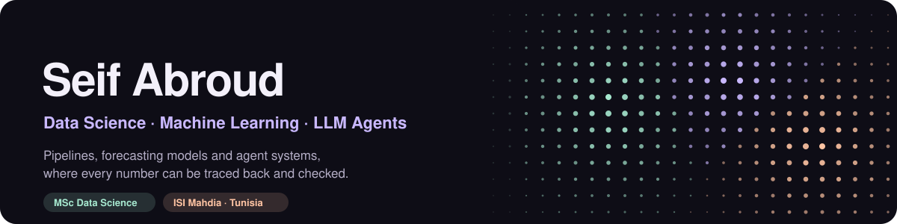
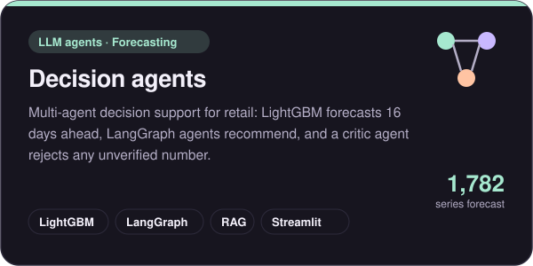
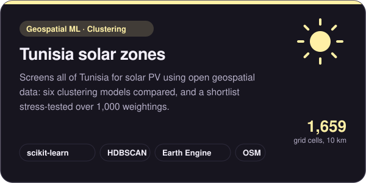
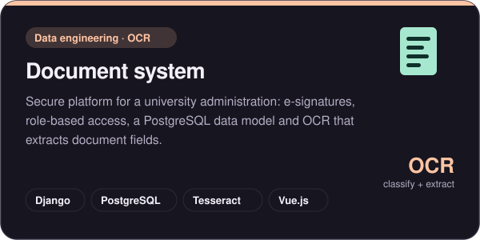
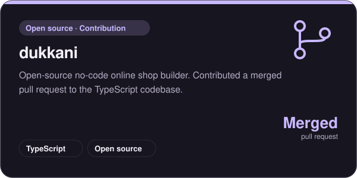

I'm a Data Science master's student at ISI Mahdia (University of Monastir, Tunisia), with a bachelor's degree in Computer Science and a background in software development. My work sits between modelling and engineering: I take a loosely defined question, build the pipeline that answers it, and make sure every result can be traced back and checked.

Most of my projects ship as something you can run, such as a dashboard, an app or a reproducible notebook, not only as an analysis.

### Selected projects

Solar zones built with Ghezlen Ben Abdrahmen. The document system was built during an internship at ISIMA and is private.

### How I work

- **Numbers come from code, not from the model.** In my agent systems the LLM computes nothing: deterministic tools produce every figure, and each one is logged as evidence.
- **Real data, or no data.** Gaps stay gaps. I would rather report a missing value than fill it with something invented.
- **Beat a baseline first.** Forecasts are compared with seasonal-naive and moving-average references before any claim is made.
- **State the limits.** Every project README says what the work does not tell you.

### Tools I built

[WeTransfer-Automation](https://github.com/SeifAbroud/WeTransfer-Automation) (Selenium upload and share-link pipeline) ·
[litterwatch](https://github.com/SeifAbroud/litterwatch) (folder watcher with automatic upload) ·
[image-copyright-stamper](https://github.com/SeifAbroud/image-copyright-stamper) (batch metadata writer, ExifTool) ·
[Directory-organizer](https://github.com/SeifAbroud/Directory-organizer) (rule-based file sorting)

### Tools & technologies

**Languages** 
    

**Data & machine learning** 
     

**LLM systems** 
   

**Data engineering & BI** 
      

**Software** 
      

**Analytics & collaboration** 
   

---

**Education** MSc Data Science, ISI Mahdia (2025–2027) · BSc Computer Science, ISI Mahdia (2022–2025), Highest Honors 
**Languages** Arabic · English (C1) · French 
**Contact** abroudseif@gmail.com · [LinkedIn](https://www.linkedin.com/in/seif-abroud-28107a245/)
